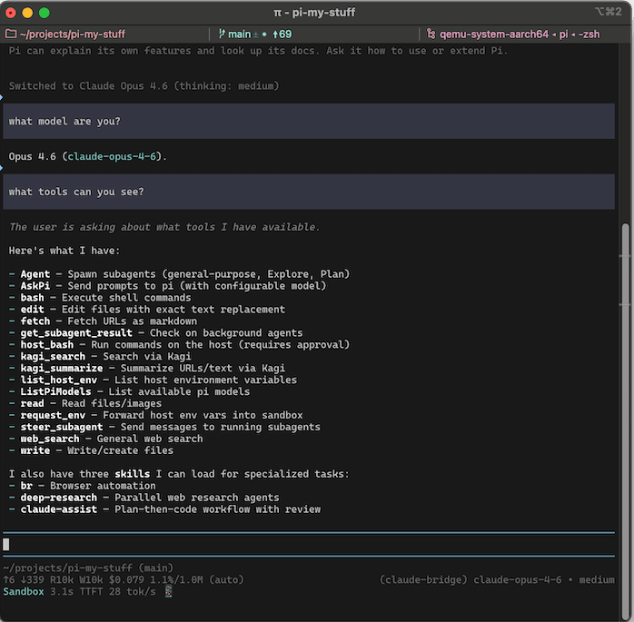
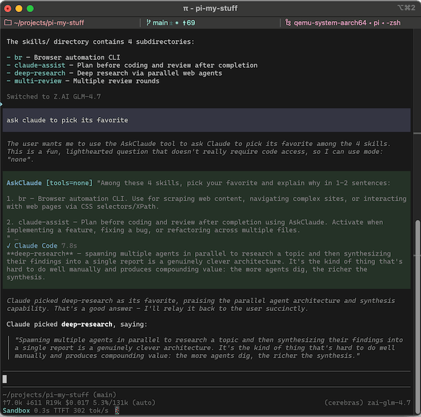

# pi-claude-bridge

Local dotfiles extension using persistent Claude Code sessions. Pi remains the harness; Claude stays alive between user turns.

Imported from our persistent-session implementation at `860a0258b9da5577158ae77c32c509f0309b062b`. This code is maintained directly in dotfiles, not installed or updated from an upstream Git package. The original bridge's MIT license is preserved in `LICENSE`.

Pi extension that integrates Claude Code via the [Agent SDK](https://github.com/anthropics/claude-agent-sdk-typescript). Originally based on [claude-agent-sdk-pi](https://github.com/prateekmedia/claude-agent-sdk-pi) by Prateek Sunal.

1. **Provider** — Use Opus/Sonnet/Haiku as models in pi, with all tool calls flowing through pi's TUI
2. **AskClaude tool** — Delegate tasks or questions to Claude Code when using another provider


**FYI:** Anthropic [announced and then unannounced](https://support.claude.com/en/articles/15036540-use-the-claude-agent-sdk-with-your-claude-plan) a change to how you would be billed for tools that use the Agent SDK like this one. It currently uses your regular subscription quota just like Claude Code.

<p>
<a href="assets/claude-bridge1.png"></a>&nbsp;
<a href="assets/claude-bridge2.png"></a>
</p>

## Install

1. Run `npm ci --ignore-scripts` in the parent `home/.pi/agent/extensions/` directory (also handled by `dot` setup), then `dot stow`. Pi automatically discovers this directory's `index.ts` through `~/.pi/agent/extensions/`.
2. Log in to Claude Code with your Claude subscription: run `claude` and type `/login`. The bridge uses Claude Code's login, not pi's `/login`.
3. Reload Pi and pick a `claude-bridge/...` model with `/model`. (Do not use the `anthropic/...` models)

Do not install a second Git or npm copy of this extension. Install Claude Code 2.1.248+ on `PATH` (or set `provider.pathToClaudeCodeExecutable`). This fork is tested with Pi 1.4.0 and Claude Code 2.1.316.

## Provider

Use `/model` to select any Claude model in pi-ai's catalog, e.g. `claude-bridge/claude-fable-5-1`, `claude-bridge/claude-opus-5`, or `claude-bridge/claude-haiku-4-5`.

Behind the scenes, pi's tools are bridged to Claude Code but everything works like normal in pi. Bash commands get Claude Code's 120-second default timeout since pi's bash has none. Skills are forwarded to Claude Code's system prompt, and steering mid-turn reaches Claude at the next tool boundary.

Each Pi session owns one long-running Claude process. Successful replies leave it alive; it stops after an idle hour (how long the prompt cache lasts) and resumes saved history on the next prompt. Tool execution, permission prompts and subagents are **not idle**. Interruptions drain the active turn without killing a healthy process; cancellation before the prompt is acknowledged retires the process so queued input cannot run later. Model and effort changes apply live, and so do added tools (through MCP `tools/list_changed`). Removed or redefined tools, forwarded instructions, connection settings or output limits restart it: Claude Code keeps offering every tool definition it has already sent, so only a restart takes one away. Session shutdown/reload closes and awaits its processes without closing other Pi sessions' processes.

Claude user/project settings, hooks, native skills, MCP servers, auto-memory and auto-compaction are disabled on the provider path. Pi supplies their equivalents. Claude receives Pi prompts verbatim; instruction changes are not frozen in a saved Claude system-prompt snapshot.

The model list comes from pi-ai's Anthropic catalog automatically — when pi-ai adds a new Claude model, it appears in `/model` after updating the package, no bridge update needed. Dated snapshot ids (e.g. `claude-opus-4-5-20251101`) are not shown.

**1M Context:** Fable 5/5.1, Opus 5.5/5/4.8/4.7, and Sonnet 5.5/5 get 1M context. Opus 4.6 gets 1M only on a Max plan or with Extra Usage, and Sonnet 4.6 only with Extra Usage — set `provider.plan` and/or `provider.longContextExtraUsage` as described in [Configuration](#configuration).

## AskClaude Tool

**Deprecated:** AskClaude is an opt-in legacy tool and may be removed in a future release. You should set `askClaude.enabled` to `true` (see [Configuration](#configuration)) to use it. You can recreate similar functionality with one of the many Pi subagent extensions.

## Configuration

Config: `~/.pi/agent/claude-bridge.json` (global) or the project Pi config directory, usually `.pi/claude-bridge.json` (project; merged over global). `provider` settings are read only from the global file, so a cloned repo can't point the bridge at its own executable or turn on metered billing.

```json
{
  "askClaude": {
    "enabled": true,
    "allowFullMode": true,
    "defaultIsolated": false,
    "description": "Custom tool description override"
  },
  "provider": {
    "plan": "max",
    "longContextExtraUsage": false,
    "pathToClaudeCodeExecutable": "/home/you/.nix-profile/bin/claude"
  }
}
```

`askClaude`:
- `enabled` — register the AskClaude tool (default `false`).
- `name` — override the tool's pi-side name (default `"AskClaude"`)
- `label` — override the TUI label (default `"Ask Claude Code"`)
- `description` — override the tool description. Default when `allowFullMode: true`: *"Delegate to Claude Code for a second opinion or analysis (code review, architecture questions, debugging theories), or to autonomously handle a task. Defaults to read-only mode — use full mode when the user wants to delegate a task that requires changes. Prefer to handle straightforward tasks yourself."*
- `defaultMode` — `"read"` (default), `"none"`, or `"full"`
- `defaultIsolated` — start each call in a fresh session (default `false`)
- `allowFullMode` — allow `mode: "full"`; set `false` to lock it out
- `appendSkills` — forward pi's skills block into the system prompt (default `true`)

`provider`:
- `plan` (default `"pro"`) — set to `"max"` if you have a Max (or Team Premium/Enterprise) Anthropic plan. This enables Opus with 1M context.
- `longContextExtraUsage` — set to `true` to enable 1M context models even if they cost money through Extra Usage on your plan. It enables Sonnet 4.6 with 1M on every plan and Opus 4.6 with 1M on Pro.
- `forceTwoHundredK` — array of model ids to pin to 200K context (bare id, no `[1m]` suffix). Use if pi-ai declares a model at 1M but Claude Code won't serve it on your plan.
- `strictMcpConfig` and `autoMemoryEnabled` no longer change provider behavior: native Claude MCP configuration and auto-memory are always disabled. The deprecated AskClaude delegation tool retains its separate legacy settings.
- `pathToClaudeCodeExecutable` — override the installed `claude` executable; defaults to `claude` on `PATH`. The provider does not use the SDK's bundled executable.


**Notices:** there is no provider welcome or plan reminder. The deprecated AskClaude tool still shows a notice on first use and records its display date as `askClaudeDeprecationShown`.

**Extension providers and models.json:** pi's `modelOverrides` in `~/.pi/agent/models.json` do not work correctly with pi-claude-bridge; they only apply to pi-side settings like compaction threshold. Overriding `contextWindow` or other fields requires editing `src/models.ts` directly — to pin a model to 200K, use `provider.forceTwoHundredK` instead.

**Claude Code's environment:** Claude Code inherits pi's environment. For variables only bridge requests should get (a proxy, a gateway, Bedrock settings), add an `env` object to a `claude-bridge` credential in `~/.pi/agent/auth.json`; its values override pi's, and an empty value removes the variable. Extensions calling a bridge model can pass `env` per request the same way. `CLAUDE_CONFIG_DIR`, `HOME` and `USERPROFILE` can't be set there (the turn fails), since the bridge reads Claude Code's session files through pi's own values.

This example sends bridge requests through a proxy and keeps an exported gateway (issue #107) away from Claude Code, so it uses your Claude login:

```json
{
  "claude-bridge": {
    "type": "api_key",
    "key": "not-used",
    "env": {
      "HTTPS_PROXY": "http://127.0.0.1:8080",
      "ANTHROPIC_BASE_URL": "",
      "ANTHROPIC_API_KEY": "",
      "ANTHROPIC_AUTH_TOKEN": ""
    }
  }
}
```

## Tests

Dependencies are managed by the parent `extensions/package.json` and lockfiles. Run `npm run typecheck` and `npm test` there to check all extensions, including this bridge. For the bridge suite alone, run `npm run test:unit` here for offline tests, including real Claude CLI subprocesses against a local HTTP stub. Persistent-session tests verify native process reuse, interruption/drain, idle expiry/resume, startup cancellation, model/effort updates, live tool additions, configuration restarts and session isolation without using your credentials or subscription. `npm test` adds integration tests that hit APIs; set `CLAUDE_BRIDGE_TESTING_ALT_MODEL` in `.env.test` for the alt-provider smoke test.

Integration tests spawn real `pi` and Claude Code subprocesses and need write access to `~/.claude` — a sandbox that blocks it makes `--resume` fail with `No conversation found with session ID`.

## Debugging

Set `CLAUDE_BRIDGE_DEBUG=1` to enable debug output:

- **Bridge log** at `claude-bridge.log` in pi's agent dir (`PI_CODING_AGENT_DIR`, default `~/.pi/agent`) — provider calls, session sync decisions, tool results, CC stderr. Override location with `CLAUDE_BRIDGE_DEBUG_PATH`.
- **Per-query CC CLI logs** at `cc-cli-logs/<timestamp>-<tag>-<seq>.log` in the same directory — the subprocess's own debug stream; tag is `provider` or `askclaude`. Shows CC's view of session loading, API requests, and tool calls.

When filing a bug about a session-resume failure (e.g. "No conversation found"), the most useful attachments are the `syncResult:` lines from the bridge log plus the matching `cc-cli-logs/` file for the failing query.

## Compatibility with other extensions

### Which injection routes reach Claude Code

The bridge forwards pi's structured parts — project context files, skills, custom prompt, appended instructions, and custom prompt sections (`systemPromptOptions.sections`) — and drops the rest. Measured against the request body (`diag/capture-proxy.mjs`):

| Route | Reaches Claude Code |
|---|---|
| `before_agent_start` -> `message` | Yes, as literal prompt text in the user turn |
| `context` editing the last user message | Yes, as literal prompt text |
| `--append-system-prompt` | Yes, with pi's appended instructions |
| `context_with_system` editing the system message | Yes when it wraps pi's prompt; the turn fails when it replaces one |
| `before_agent_start` -> `systemPromptOptions.sections` | Yes, one `<name>` block per section |
| `before_agent_start` -> `systemPrompt` | No, dropped |

Two traps. Returning `systemPrompt` from `before_agent_start` makes pi replace the whole system prompt, discarding any `context_with_system` edit in the same run — only one reaches the request. And system-prompt edits work by *wrapping*: replacing pi's prompt leaves the bridge with nothing to match, so it refuses the turn rather than send Claude Code a request missing your context files, skills and custom instructions. The error names the closest known prompt and where it diverged.

To add instructions, use `message`, `context`, or a system-message edit that keeps pi's prompt intact.

### Hooks written for Claude Code

User and project Claude settings/hooks do not run in provider turns or isolated summary queries. Port required behavior to Pi extensions. Put gateway/cloud environment configuration in Pi's provider `env` or the launching shell, rather than Claude settings files. Only the deprecated AskClaude delegation tool retains Claude user settings.

### Compaction and branch summaries

pi runs compaction and branch summaries natively. The bridge routes their `cacheRetention: "none"` calls to isolated Claude Code queries, leaving the live session untouched until pi completes the history rewrite. Other extensions can provide summaries through pi's hooks. This deliberately differs from OpenCode's cache-sharing summary fork: Pi supplies a complete summary transcript, so its explicit one-shot request is preserved instead of duplicating that transcript inside the live conversation.

### System prompt rejections

Other extensions can change the system prompt. When the result still contains pi's built-in system prompt text, or the two documentation paths that Anthropic looks for (`docs/custom-provider.md` in the same prompt with `docs/packages.md`), the bridge stops the turn instead of sending it, since Anthropic may otherwise bill these requests as Extra Usage. Fix the source extension before retrying; `CLAUDE_BRIDGE_DEBUG=1` writes the full prompt to the bridge log when this happens.

### Plan usage for footers and quota extensions

The bridge does not show plan usage itself. Claude Code sends a `rate_limit_event` when a usage window changes, and the bridge passes it to pi's `after_provider_response` event as `anthropic-ratelimit-unified-*` headers. Events are not tied to one response: one that arrives after a turn has ended on a tool call is reported on the next provider call, and only the latest is kept. The headers use the names that the Anthropic API uses (for example `anthropic-ratelimit-unified-5h-utilization`). The bridge sends only the headers that it can make from the event: the status, the reset time, the representative claim, the overage status and reset, and the utilization and reset of each window. The status code is always 200. An extension that reads these headers for the built-in `anthropic` provider can also accept `claude-bridge` without other changes.

### Using claude bridge with @gotgenes/pi-subagents

Requires the following in `~/.pi/agent/subagents.json`:

```json
{"promptInheritance": {"claude-bridge": "portable"}}
```

## Session history

The bridge compares conversation content before sending a new user turn. Unchanged history reuses the **live process**, not merely its saved session. After idle expiry or process restart, it resumes saved history. Tree navigation and history edits retain Claude Code's records up to the last safe matching point, then continue in a new session. Model/effort changes use SDK controls while the process is live; a model change after process shutdown imports Pi history into a fresh Claude session.

Session pointers are committed to memory at turn completion and saved only after the child exits, so they never name unflushed native records. Session pointers, content digests and record IDs are saved under `claude-bridge/sessions/` in pi's agent directory (`PI_CODING_AGENT_DIR`, default `~/.pi/agent`). They let the bridge recover its matching prefix after a restart. Running the same pi session simultaneously in multiple bridge processes is unsupported.

## Known issues

**Edits far back in history can still cost cache.** The unchanged prefix is retained, but Anthropic's cache lookup has a limited lookback. A long rewritten suffix can prevent reuse of an earlier cache entry.

**File snapshots in rewritten history can be lost.** Native records before the matching point keep their attachments. A rewritten suffix carries `@file` expansions, but not snapshots Claude Code recorded after editing files; the tool calls and results remain in pi's history.

**Exported Anthropic environment variables override the Claude Code child (issue #107).** An exported `ANTHROPIC_BASE_URL`, `ANTHROPIC_API_KEY`, or `ANTHROPIC_AUTH_TOKEN` redirects Claude Code to that gateway and every turn fails with its auth error. Unset them for the pi process, or blank them in a `claude-bridge` credential's `env` (see [Configuration](#configuration)).
